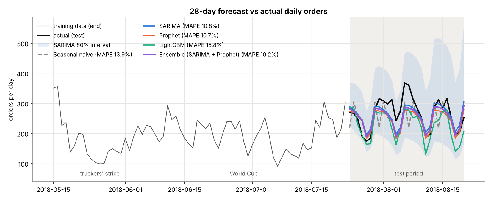
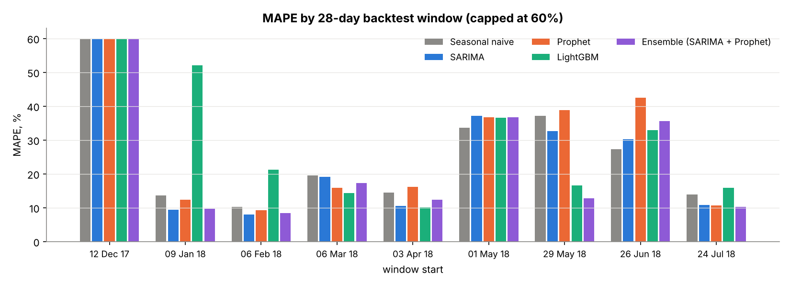

# Sales Demand Forecasting: daily orders on the Olist marketplace

Forecasting the number of **orders per day for the next 28 days** for a Brazilian e-commerce
marketplace (Olist, ~99k orders, 2016–2018), comparing a seasonal-naive baseline, SARIMA,
Prophet, LightGBM and a SARIMA + Prophet ensemble on a strict time-based holdout and a
9-window rolling-origin backtest.

| | |
|---|---|
| **Best model** | SARIMA + Prophet ensemble: **MAPE 10.2%** vs **13.9%** for the seasonal-naive baseline (−28% MAE) |
| **Robustness** | 9-window backtest: median MAPE **12.8%** vs 19.6% naive; beats the baseline in 6 of 9 windows |
| **Horizon / test** | 28 days, the last 4 weeks of data (2018-07-24 → 2018-08-20), never used for fitting |
| **Stack** | Python · pandas · statsmodels (SARIMA, STL) · Prophet · LightGBM · matplotlib · Jupyter |



## Results (test period, 28 days)

| Model | MAE | RMSE | MAPE | vs naive |
|---|---|---|---|---|
| **Ensemble (SARIMA + Prophet)** | **28.2** | 36.8 | **10.2%** | −3.7 pp |
| SARIMA(1,1,1)(0,1,1)₇ on log | 28.4 | **34.9** | 10.8% | −3.1 pp |
| Prophet + BR holidays + events | 30.2 | 40.2 | 10.7% | −3.2 pp |
| Seasonal naive (last week repeated) | 38.9 | 51.2 | 13.9% | n/a |
| LightGBM (calendar + lags ≥ 28) | 42.6 | 49.7 | 15.8% | +1.9 pp |

Test mean: 265 orders/day. SARIMA and Prophet make different errors, so their equal-weight
average beats both.

### Is it stable? Rolling-origin backtest (9 × 28-day windows, Dec 2017 → Aug 2018)

| Model | Median MAPE | Mean MAPE | Windows beating naive |
|---|---|---|---|
| **Ensemble (SARIMA + Prophet)** | **12.8%** | **24.2%** | **6 / 9** |
| Prophet | 16.1% | 28.3% | 4 / 9 |
| SARIMA | 19.1% | 26.2% | 6 / 9 |
| Seasonal naive | 19.6% | 25.7% | n/a |
| LightGBM | 21.3% | 34.8% | 3 / 9 |

Models only know events that had started before each forecast date. All models fail in the same
windows (post-Black-Friday December, the truckers' strike, the World Cup), which no model trained
on history can foresee. In normal months the ensemble's error is ~8–12%.



**Takeaways**
- **The seasonal-naive baseline is strong.** The weekly cycle (Mon/Tue busiest, Saturday −25%)
  explains most of the variation, so a model has to earn its complexity.
- **Domain knowledge beat algorithm choice.** Two real events sit right before the test window:
  the Brazilian **truckers' strike** (21–31 May 2018) and the **FIFA World Cup** (14 Jun–15 Jul 2018).
  Demand recovers just as the test starts. Marking these (and Black Friday) as special events cut
  Prophet's MAPE from 26.5% to 10.7% and LightGBM's from 21.1% to 15.8%.
- **LightGBM is handicapped by the horizon.** To avoid leakage it may only use lags ≥ 28 days, and
  those lags fall straight into the World Cup dip. Boosting would shine with many related series
  (per category or state) and richer drivers (promotions, prices).


## Approach

1. **Data:** `olist_orders_dataset.csv`. `canceled` / `unavailable` orders removed, daily count by
   `order_purchase_timestamp`, missing days filled with 0.
2. **Period: 2017-02-01 → 2018-08-20**, verified on a plot. Before February 2017 the platform was
   still ramping up. After 2018-08-20 the export is cut off (orders fall from ~250 to 0 within a week).
3. **EDA:** trend (growth in 2017, plateau in 2018), weekly seasonality, STL decomposition
   (multiplicative weekly pattern), **Black Friday 24.11.2017 = 1,166 orders (~6× a normal day)**,
   2018 strike and World Cup dips.
4. **Split by time:** last 28 days = test. No random split, because it would leak the future
   into training.
5. **Models, horizon 28 days:**
   - *Seasonal naive*: the last observed week repeated (same weekday one week earlier).
   - *SARIMA* with weekly seasonality on `log(orders)`, orders selected by AIC on train.
   - *Prophet* with `add_country_holidays("BR")` + Black Friday / strike / World Cup windows,
     multiplicative seasonality.
   - *LightGBM*: `dayofweek`, `month`, `day`, `is_holiday`, `lag_28/35/42`, `rolling_mean_7/28`
     shifted by 28 days, plus event flags. Every feature is known 28 days in advance, so there is
     **no leakage**.
6. **Metrics:** MAE, RMSE, MAPE (safe here: the smallest test value is 175 orders).

The [notebook](notebooks/forecasting.ipynb) explains every step in markdown, including the
reasoning behind the period, the log transform, the lag rule and the metric choice.

## Run it

```bash
python -m venv .venv && source .venv/bin/activate
pip install -r requirements.txt
jupyter notebook notebooks/forecasting.ipynb
```

The notebook finds the data in this order: the Kaggle input `olistbr/brazilian-ecommerce`, then
`data/olist_orders_dataset.csv`, and otherwise it downloads the file from
[Olist's public GitHub repository](https://github.com/olist/work-at-olist-data). The whole
notebook runs in under a minute on a laptop.

`notebooks/forecasting.py` is the plain-text source of the notebook (cells marked with `# %%`, easy to
diff). `python scripts/build_notebook.py` regenerates the `.ipynb` from it.

## Limitations and next steps
- The event handling was motivated by the EDA, and its effect is shown on the same test window.
  A stricter setup would choose model variants on a separate validation window.
- Forecast intervals matter more than point forecasts for staffing. The SARIMA 80% interval is
  shown on the plot.
- Next: forecasts per category / state with reconciliation, and promotions and marketing as regressors.

## Project structure

```
├── notebooks/
│   ├── forecasting.ipynb     # main notebook (executed, with outputs)
│   └── forecasting.py        # plain-text source of the notebook
├── reports/
│   ├── results.csv           # hold-out comparison table
│   ├── backtest_summary.csv  # 9-window backtest summary
│   └── figures/              # all charts
├── scripts/build_notebook.py # .py → .ipynb
├── data/                     # put olist_orders_dataset.csv here (optional, not committed)
└── requirements.txt
```

Data: [Brazilian E-Commerce Public Dataset by Olist](https://www.kaggle.com/datasets/olistbr/brazilian-ecommerce), CC BY-NC-SA 4.0.
