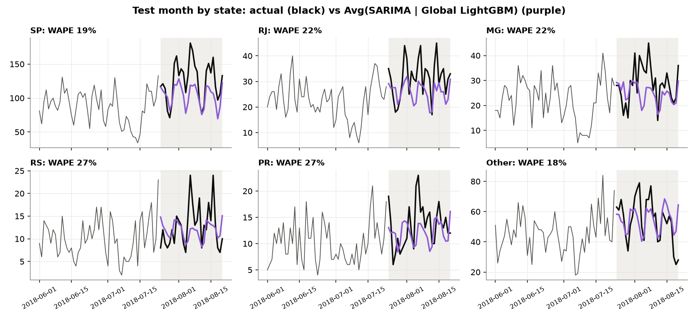
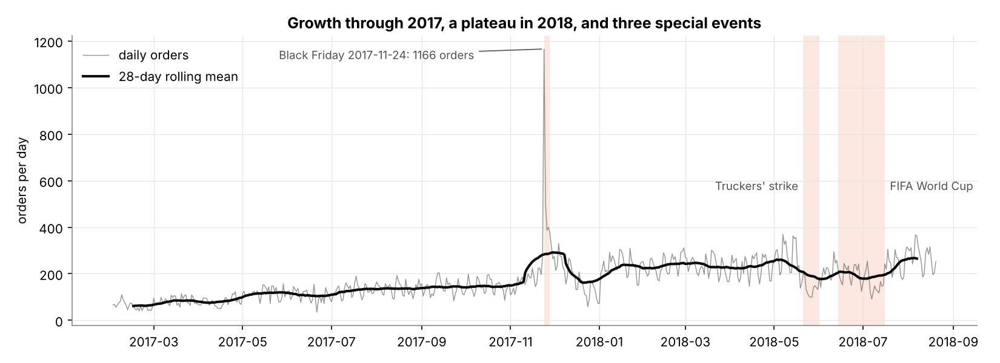

# Sales Demand Forecasting: daily orders on the Olist marketplace

Forecasting the number of **orders per day for the next 28 days** for a Brazilian e-commerce
marketplace (Olist, ~99k orders, 2016–2018), nationally and for the 5 largest states. Seasonal
naive, SARIMA, Prophet, LightGBM and their averages are compared under a strict protocol:
**every modelling decision is made on 8 rolling validation windows, and the test month is
used once, at the end.**

| | |
|---|---|
| **Final model** | Average of SARIMA and Prophet, **chosen on validation only** |
| **Test month** | **WAPE 10.6%** (MAPE 10.2%, MASE 0.79) vs **14.7%** for the seasonal-naive baseline |
| **Validation** | Median WAPE **13.4%** vs 20.1% naive over 8 windows; better than naive in 6 of 8 |
| **Honest caveat** | Treating the World Cup as unknown in advance flips the choice, and the test WAPE becomes 16.1% (worse than naive) |
| **Stack** | Python · pandas · statsmodels (SARIMA, STL) · Prophet · LightGBM · matplotlib · Jupyter |


## How the models were evaluated

A single test month is too small to choose models on, and choosing on it makes the score
optimistic. So:

1. **Test set:** the last 28 days (2018-07-24 → 2018-08-20). Not looked at until all
   decisions were fixed.
2. **8 validation windows:** the eight 28-day periods before the test (Dec 2017 → Jul 2018).
   For each one every model is refitted on the data before it (rolling origin).
3. **Decided on validation only:** the SARIMA orders (by AIC on data before the first window),
   whether Prophet and LightGBM use the special-event information, and which models to
   average.
4. **What was known when:** scheduled events (Black Friday, the FIFA World Cup) are on the
   calendar, so their dates are known in advance. The truckers' strike was a surprise, so a
   model only learns about it once it has started.


## Results

### Selection on the 8 validation windows

| Model | Median WAPE | Mean WAPE | Windows better than naive |
|---|---|---|---|
| **Avg(SARIMA, Prophet + events)** | **13.4%** | **19.0%** | **6 / 8** |
| Avg(SARIMA, Prophet + events, LightGBM) | 15.5% | 21.2% | 4 / 8 |
| Prophet + events | 16.9% | 23.2% | 6 / 8 |
| Seasonal naive | 20.1% | 23.3% | n/a |
| SARIMA | 20.5% | 21.4% | 6 / 8 |
| LightGBM (no events) | 25.0% | 30.0% | 3 / 8 |

The mean is much higher than the median because three windows are dominated by shocks that
no model trained on history can foresee: December 2017 (after Black Friday), May 2018 (the
strike started inside the window) and late June 2018 (World Cup).

### Test month (28 days, evaluated once)

| Model | WAPE | MAPE | MAE | RMSE | MASE |
|---|---|---|---|---|---|
| **Avg(SARIMA, Prophet + events): final** | **10.64%** | **10.24%** | **28.2** | 36.9 | **0.79** |
| SARIMA(2,1,2)(0,1,1)₇ on log | 10.71% | 10.80% | 28.4 | **34.7** | 0.79 |
| Prophet + BR holidays + events | 11.69% | 10.94% | 31.0 | 41.1 | 0.87 |
| Seasonal naive (last week repeated) | 14.67% | 13.91% | 38.9 | 51.2 | 1.09 |
| LightGBM (calendar + lags ≥ 28) | 21.14% | 21.12% | 56.1 | 63.0 | 1.57 |

Test mean: 265 orders/day. All models, including the ones validation rejected, are in
[`reports/results.csv`](reports/results.csv).

### How much the result depends on one assumption

| Rule for scheduled events | Model chosen on validation | Test WAPE | Naive |
|---|---|---|---|
| Known in advance (main) | Avg(SARIMA, Prophet + events) | **10.6%** | 14.7% |
| Treated as surprises (strict) | Avg(SARIMA, Prophet without events) | 16.1% | 14.7% |

The first version of this project used the strict rule. Under it, the "with events" variants
lose in the May and June windows because the World Cup is unknown when it starts inside the
forecast window, so validation drops them, and the chosen model is worse than naive on the
test month. A planner does know the football calendar, so the main rule is the realistic
one, but the dependency is shown rather than hidden.

### Are the forecast intervals honest?

| Model | 80% interval covers (8 validation windows, 224 days) | Test month | Average width |
|---|---|---|---|
| SARIMA | **82.1%** | 100.0% | 88% of forecast |
| Prophet + events | 66.1% | 78.6% | 47% of forecast |

SARIMA's interval is well calibrated (but wide); Prophet's is too narrow and would under-staff
busy days. For staffing, use the SARIMA upper bound.

### Many series: forecasts by state

Planning is regional, so the same protocol is run on 6 series: SP, RJ, MG, RS, PR and the
rest ("Other"). They add up exactly to the national total. One **global LightGBM** learns from
all states at once (lags and target divided by each state's own level), while SARIMA and
Prophet fit each state separately.

| Model | Validation: state-level WAPE (median) | Test: state-level WAPE | Test: bottom-up national WAPE |
|---|---|---|---|
| **Avg(SARIMA, global LightGBM): chosen** | **20.8%** | 20.1% | 14.9% |
| Prophet per state | 23.6% | **17.7%** | **11.2%** |
| SARIMA per state | 25.9% | 18.1% | 11.8% |
| Seasonal naive | 28.2% | 23.2% | 14.7% |
| Global LightGBM | 29.3% | 23.7% | 18.6% |

On the test month the chosen model beats naive in 5 of 6 series (RJ is slightly worse: 22.4%
vs 21.6%), most clearly in the small states (RS 26.8% vs 38.0%, PR 27.0% vs 33.2%). On this particular test
month per-state Prophet did better; that is reported, not re-selected.



## Takeaways

- **The protocol changes the story.** Choosing on validation instead of the test month is
  what makes 10.6% defensible, and it exposed one assumption the result depends on.
- **Seasonal naive is a strong baseline.** The weekly cycle (Mon/Tue busiest, Saturday −25%)
  explains most of the variation, so every model has to earn its complexity.
- **Single-series LightGBM is the weakest model.** To avoid leakage it may only use lags ≥ 28
  days, and those lags fall into the World Cup dip. Across many series a global model is
  useful mainly in combination with SARIMA.
- **Check intervals, not only point forecasts.** Prophet's nominal 80% interval is
  overconfident here.



## Approach

1. **Data:** `olist_orders_dataset.csv` (+ `olist_customers_dataset.csv` for the state).
   `canceled` / `unavailable` orders removed, daily count by `order_purchase_timestamp`,
   missing days filled with 0.
2. **Period: 2017-02-01 → 2018-08-20**, verified on a plot. Before February 2017 the platform
   was still ramping up. After 2018-08-20 the export is cut off.
3. **EDA:** trend (growth in 2017, plateau in 2018), weekly seasonality, STL decomposition
   (multiplicative weekly pattern), Black Friday 24.11.2017 = 1,166 orders (~6× a normal day),
   2018 strike and World Cup dips.
4. **Models, horizon 28 days:** seasonal naive; SARIMA on `log(orders)`; Prophet with
   `add_country_holidays("BR")` and optional event windows; LightGBM with calendar features and
   lags ≥ 28 days (no leakage); averages of these; per-state SARIMA / Prophet and a global
   LightGBM.
5. **Metrics:** WAPE (main), MAPE, MAE, RMSE, MASE, interval coverage.

The [notebook](notebooks/forecasting.ipynb) explains every step in markdown, including
interview notes on the split, the lag rule and the metrics.

## Run it

```bash
python -m venv .venv && source .venv/bin/activate
pip install -r requirements.txt
jupyter notebook notebooks/forecasting.ipynb
```

The notebook finds the data on Kaggle (`olistbr/brazilian-ecommerce`), then in `data/`, and
otherwise downloads it from [Olist's public GitHub repository](https://github.com/olist/work-at-olist-data).
A full run (about 300 model fits) takes a few minutes on a laptop.

**On Kaggle:** create a notebook, *File → Import Notebook* with `notebooks/forecasting.ipynb`,
then *Add Input* → dataset `olistbr/brazilian-ecommerce`. The notebook finds the CSV files
anywhere under `/kaggle/input` and writes its charts to `/kaggle/working/figures`. No internet
is needed.

`notebooks/forecasting.py` is the plain-text source of the notebook (cells marked with `# %%`,
easy to diff). `python scripts/build_notebook.py` regenerates the `.ipynb` from it.

## Limitations and next steps
- 8 validation windows are still a small sample, and three of them are dominated by shocks.
- The event list is written by hand; in production it would come from a maintained calendar,
  together with promotions and marketing spend as regressors.
- Prophet's intervals could be recalibrated on the validation windows (conformal prediction).
- Next: category-level forecasts with reconciliation (e.g. MinT).

## Project structure

```
├── notebooks/
│   ├── forecasting.ipynb          # main notebook (executed, with outputs)
│   └── forecasting.py             # plain-text source of the notebook
├── reports/
│   ├── results.csv                # test month, all models
│   ├── validation_selection.csv   # model selection on the 8 validation windows
│   ├── sensitivity_event_rule.csv # main vs strict rule for scheduled events
│   ├── interval_coverage.csv      # 80% interval coverage
│   ├── state_results.csv          # forecasts by state
│   └── figures/                   # all charts
├── scripts/build_notebook.py      # .py → .ipynb
├── data/                          # Olist CSVs (optional, not committed)
└── requirements.txt
```

Data: [Brazilian E-Commerce Public Dataset by Olist](https://www.kaggle.com/datasets/olistbr/brazilian-ecommerce), CC BY-NC-SA 4.0.
